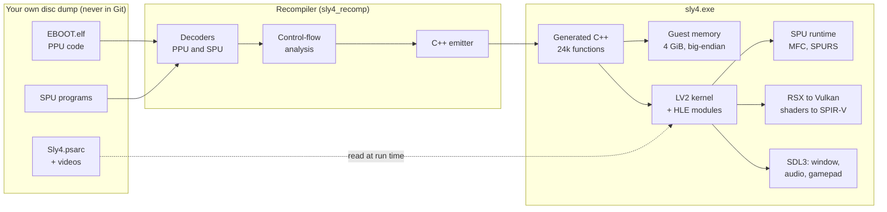

<div align="center">

# sly4-port

### A native Windows port of *Sly Cooper: Thieves in Time* (PS3), built by static recompilation

[](#building)
[](tools/README.md)
[](#the-challenge)
[](docs/GPU.md)
[](#building)
[](#building)
<br>
[](tools/docs/GHIDRA.md)
[](DISCLAIMER.en.md)
[](https://github.com/mvieira-hub/sly4-port/actions/workflows/build.yml)
[](LICENSE)

[Português](README.md) · **English**

</div>

> [!IMPORTANT]
> **No game content is included in this repository.** No executable, assets, firmware or keys
> from Sony Interactive Entertainment or Sanzaru Games. The tools only work on a dump of a
> disc you own. Read the [legal notice](DISCLAIMER.en.md).

---

## Overview

*Sly Cooper: Thieves in Time* (2013, BCES01284) only runs on the PlayStation 3 or under emulation.
This project translates the game's own machine code, ahead of time, into C++ that compiles to a
regular Windows program. A native runtime then stands in for the console's operating system and
hardware.

There is no emulator loop at run time. The game's PowerPC and SPU code runs as compiled x86-64,
and an interpreter is only a fallback for code that was not seen before. The goal is
**software preservation** and **interoperability**: keep a game playable on hardware that is
still being made, from a copy its owner already has.

**Where it is today:** the game boots, plays its intro video and menus with music, and its
**first level is playable**. The Paris prologue loads and renders, and Sly runs, jumps and
double-jumps with a gamepad or keyboard, with sound, at 30–34 frames per second.

## The challenge

The PS3's Cell Broadband Engine is very different from a PC, and every part of it has to be
reproduced:

| PS3 | What it is | How this port handles it |
|---|---|---|
| **PPU** | PowerPC 64, big-endian, with VMX (AltiVec) and Cell-specific instructions | Each function becomes C++ with branches turned into `goto` and calls into direct calls |
| **SPUs** | 6 vector co-processors, each with 256 KiB of local store, fed only by DMA | SPU code is recompiled per block, with DMA, channels, mailboxes and atomics reimplemented |
| **LV2 kernel** | Threads, sync primitives, timers, memory, file system | Mapped onto Win32 threads, events and files |
| **System modules** | `cellFs`, `cellGcm`, `cellSpurs`, `cellAudio`, `cellPad`, `cellSaveData`... | High-level reimplementation; SPURS runs the console's own firmware, recompiled |
| **RSX GPU** | NV47-class GPU fed by a command FIFO, with Cg shaders | FIFO decoded into Vulkan 1.3; shader bytecode translated straight to SPIR-V |
| **Memory** | 32-bit guest pointers, big-endian data | 4 GiB guest address space reserved on the host, byte-swapped access |

## Architecture



## Technical accomplishments

### Static recompiler: PowerPC 64 (PPU)
- Own decoder for the full PPU instruction set, including the Cell additions (`lvlx`, `lvrx`) that
  Ghidra and Capstone do not decode. On all 2.8 million instructions its output is identical to
  GNU binutils.
- Control-flow analysis recovers **23,913 functions**, 301 thousand basic blocks and all **178 jump
  tables**, and tells code from the 10,044 data words embedded in `.text`.
- The emitter turns **2.77 million instructions into 24,164 C++ functions** in 98 files that
  compile without warnings. Indirect calls go through a dispatch table, with the interpreter
  as fallback.
- A reference interpreter covers integers, the FPU with the full FPSCR, and VMX. It was
  validated against real PowerPC execution under QEMU: 195 instructions, 195,000 cases, no
  divergence.

### SPU recompiler and SPURS
- SPU decoder identical to `spu-elf-objdump` on all 266,842 words of the game's 10 SPU programs.
- SPU code is recompiled into **verified blocks** that only run while the local store still holds
  the code they came from. 60,382 blocks are compiled from a cache recorded during play.
- The console's own SPURS scheduler (`libsre`) is loaded from the user's firmware, relocated and
  recompiled: 384 functions, running on 6 SPU threads.
- MFC DMA with lists and stall-and-notify, SPU interrupts, and atomic reservations shared between
  PPU `stwcx.` and SPU `putllc`, following RPCS3's semantics.

### Kernel, system modules and I/O
- 251 imported functions from 20 modules are resolved by NID, and 71 system calls are named.
- LV2 threads and every sync object the game uses: lwmutex, mutex, condition, rwlock, semaphore,
  event flag, event queue and port, timers. Plus `sys_mmapper` and a virtual file system.
- `cellSaveData` drives the game's own callbacks; `cellAudio` mixes into WASAPI; `cellPad` reads
  gamepad and keyboard through SDL3, with rumble. The Bink intro video plays through the game's
  own recompiled decoder.

### RSX to Vulkan 1.3
- Command FIFO, register state tracking, surfaces kept coherent with guest memory through page
  protection, and 2D blits on the GPU.
- All **541 vertex and fragment programs** of the game are translated directly from RSX bytecode
  to SPIR-V, with no intermediate shading language.
- Title screen and main menu were compared frame by frame with RPCS3 captures and match.

### Asset and format research (Python)
Every format below was reverse-engineered from the game's data and from its loader code in the
executable, then implemented as a script in [`tools/`](tools/README.md):

| Format | Tool | Result |
|---|---|---|
| PSARC archives | `psarc.py` | Full extraction; 148,603 compressed blocks verified against zlib |
| Sanzaru chunk containers (`.san`, `.san.cooked`) | `sanchunks.py` | Generic walker for the engine's chunk tree |
| Textures (TEXR / GTF) | `texr2dds.py` | 49,981 textures converted to DDS, lossless |
| Scripts (XMLB) | `xmlb2json.py` | XML/JSON output, 85% of names recovered |
| Meshes and levels (MESH, GINS) | `san2gltf.py` | 87 levels exported to glTF with hierarchy, materials and textures |
| Skinned geometry (PlayStation EDGE) | `edge.py` | Compressed index stream and skinning decoded from the SPU code |
| Animation (Havok 2011.3) | `havok.py` | All 4,320 clips decode and export to glTF |
| Shaders (Cg binaries) | `cgbin_info.py` | Inventory of all 541 programs |
| Executable map (EBOOT) | `eboot_scan.py` | Imports, syscalls, TOC and chunk handlers, applied to Ghidra |

## Verification first

Every layer is checked against an independent reference before the next one is built on it.

| What | Checked against | Result |
|---|---|---|
| PPU decoder | GNU binutils `objdump` | 2.8 M instructions, 0 differences |
| PPU interpreter | Real PowerPC execution under QEMU | 195,000 cases, 0 divergences |
| Generated PPU C++ | The interpreter, on random states | 98,332 cases, all equal |
| SPU decoder | `spu-elf-objdump` | 266,842 words, 0 differences |
| Generated SPU C++ | The SPU interpreter | 3,685,525 cases, all equal |
| SPU code end to end | The game's own zlib task vs. native inflate | 2,000 blocks equal (4.4 billion SPU instructions) |
| Native inflate | Python's `zlib` | 148,603 blocks (9.01 GiB) equal |
| Boot sequence | RPCS3 log | Identical line by line up to `cellGcmInit` |
| Rendering | RPCS3 screenshots | Title and menu match |

About 25,600 lines of hand-written C++20 and 3,900 lines of Python, with 51 unit test cases that run
in CI on a Windows runner.

## Bug hunts worth reading

Some of the most interesting problems came from tiny differences between the Cell and x86:

- **A NaN that was a number.** Loading hung forever inside a physics task. SPU single-precision
  floats have no NaN or infinity, so `0x7FFFFFFF` is simply the largest number, but x86 treats it
  as NaN and every comparison failed. ([FASE7.md](docs/FASE7.md), 7b)
- **White dots from a reciprocal that was too exact.** The game's anti-aliasing on the SPUs
  relies on the hardware's reciprocal *estimate* being slightly below the true value. An exact
  `1/x` pushed one blend weight to 256, which overflowed into bright pixels on character edges.
  The fix reproduces the SPU's piecewise-linear estimate. ([FASE7.md](docs/FASE7.md), 7i)
- **A silent game.** Audio worked, but the save-data stub left the settings zeroed, volumes
  included. ([FASE6.md](docs/FASE6.md), 6a)
- **A green intro video.** The Bink decoder was right. The renderer was writing an old surface
  over the video planes, which led to tracking drawn surfaces with page protection.
  ([FASE6.md](docs/FASE6.md), 6d)

## Roadmap

| Phase | Scope | Status |
|---|---|---|
| 0 | Toolchain, window, Vulkan, CI | ✅ Done |
| 1 | Guest memory and ELF loader | ✅ Done |
| 2 | PPU recompiler | ✅ Done |
| 3 | LV2 kernel and system modules: the game boots | ✅ Done |
| 4 | SPU recompiler and SPURS | ✅ Done |
| 5 | RSX to Vulkan: menus render correctly | ✅ Done |
| 6 | Audio, controller, saves and video | ✅ Done |
| 7 | First playable level | ✅ Done |
| 8 | Full game, 60 FPS, higher resolutions, installer | 🚧 Next |

The full plan, with the audit of the executable and the exit criteria of every phase, is in
[docs/ROADMAP.md](docs/ROADMAP.md).

## Repository structure

```text
app/          Entry point: window, input, command-line options
recomp/       Recompiler: PPU and SPU decoders, control-flow analysis, C++ emitters,
              differential oracles
runtime/
  memory/     Guest address space, big-endian access
  loader/     ELF/PRX loader, NIDs, TLS, SPU ELF
  cpu/        PPU and SPU contexts, instruction semantics, interpreters, MFC, atomics
  kernel/     LV2 syscalls, threads, sync, VFS, HLE modules, SPU threads, SPURS
  rsx/        RSX command FIFO and state
  gpu/        Vulkan renderer, shader translation to SPIR-V, textures
  core/       Logging, inflate, PNG, timing helpers
tests/        Unit tests and differential test programs
tools/        Python research tools, Ghidra scripts, disassembler and QEMU oracle images
docs/         Engineering notes, one file per phase or subsystem
docker/       Build toolchain image and build script
cmake/        MinGW-w64 toolchain file
```

Never committed: `PS3_GAME/` (your dump), `work/` (tool outputs), `generated/` (C++ generated
from your executable) and `build/`.

## Building

Everything builds inside Docker, so the host only needs **Docker Desktop and Git**. The result is
a single Windows `.exe` with no DLLs, built with MinGW-w64 GCC 14, CMake, Ninja and a static SDL3.

```powershell
.\docker\build.ps1 -Jobs 6                 # Release: build\mingw-release\sly4.exe
.\docker\build.ps1 -Config Debug -Jobs 6   # Debug:   build\mingw-debug\sly4.exe
.\build\mingw-release\sly4_tests.exe       # unit tests
```

Without a game dump this builds the runtime, the recompiler and the tests, which is what CI does.
To run the game you need: Windows 10/11 x64 and a GPU with Vulkan 1.3.

## Using it with your own copy

1. **Dump your own disc** of *Sly Cooper: Thieves in Time* (BCES01284) into `PS3_GAME/`.
2. **Decrypt the executable** with [RPCS3](https://rpcs3.net), which writes `EBOOT.elf` next to
   `EBOOT.BIN`:
   ```powershell
   & "C:\path\to\rpcs3\rpcs3.exe" --decrypt "PS3_GAME\USRDIR\EBOOT.BIN"
   ```
3. **Generate the C++** for the PPU code, the SPURS firmware module and the SPU programs, then
   build again. The commands are in [docs/RECOMP.md](docs/RECOMP.md) and
   [docs/SPU.md](docs/SPU.md).
4. **Run**:
   ```powershell
   .\build\mingw-release\sly4.exe --game PS3_GAME --firmware work\firmware
   ```

The research tools run in a Python container: start with [tools/README.md](tools/README.md).

## Documentation

The engineering notes are written in Portuguese.

| Document | Subject |
|---|---|
| [ROADMAP.md](docs/ROADMAP.md) | Audit of the game, architecture, phases and exit criteria |
| [RECOMP.md](docs/RECOMP.md) | PPU decoder, analysis, interpreter and C++ emitter |
| [KERNEL.md](docs/KERNEL.md) | LV2 kernel, threads, file system, system modules |
| [SPU.md](docs/SPU.md) | SPU decoder, interpreter, recompiler, SPURS and MFC |
| [GPU.md](docs/GPU.md) | RSX, Vulkan renderer, shader translation, RPCS3 comparison |
| [FASE6.md](docs/FASE6.md) | Saves, audio, controller and video |
| [FASE7.md](docs/FASE7.md) | First playable level and the bugs behind it |
| [tools/](tools/README.md) | Data formats and research tools (EDGE, Havok, shaders, Ghidra) |

## Acknowledgements

- [RPCS3](https://github.com/RPCS3/rpcs3), the reference for the console's behaviour and the tool
  that decrypts the executable.
- [GNU binutils](https://www.gnu.org/software/binutils/) and [QEMU](https://www.qemu.org), used as
  independent oracles for the decoders and the interpreter.
- [Ghidra](https://ghidra-sre.org), [SDL3](https://libsdl.org) and the
  [Vulkan](https://www.vulkan.org) ecosystem.

## Legal

This is an independent, non-commercial research project focused on software preservation and
interoperability. It is not affiliated with or endorsed by Sony Interactive Entertainment or
Sanzaru Games. *Sly Cooper* is a trademark of Sony Interactive Entertainment LLC. No proprietary
code, assets or keys are included, and the project does not support piracy: you need your own,
legitimately purchased copy of the game. See [DISCLAIMER.en.md](DISCLAIMER.en.md).

The original code in this repository is released under the [MIT License](LICENSE).
