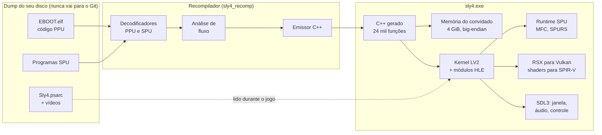

<div align="center">

# sly4-port

### Um port nativo para Windows de *Sly Cooper: Thieves in Time* (PS3), feito por recompilação estática

[](#compilação)
[](tools/README.md)
[](#o-desafio)
[](docs/GPU.md)
[](#compilação)
[](#compilação)
<br>
[](tools/docs/GHIDRA.md)
[](DISCLAIMER.md)
[](https://github.com/mvieira-hub/sly4-port/actions/workflows/build.yml)
[](LICENSE)

**Português** · [English](README.en.md)

</div>

> [!IMPORTANT]
> **Nenhum conteúdo do jogo está neste repositório.** Não há executável, assets, firmware nem
> chaves da Sony Interactive Entertainment ou da Sanzaru Games. As ferramentas só funcionam com o
> dump de um disco que você possui. Leia o [aviso legal](DISCLAIMER.md).

---

## Visão geral

*Sly Cooper: Thieves in Time* (2013, BCES01284) só roda no PlayStation 3 ou em emulador. Este
projeto traduz, antes da execução, o próprio código de máquina do jogo para C++, que compila como
um programa comum de Windows. Um runtime nativo faz o papel do sistema operacional e do hardware
do console.

Não há laço de emulação durante o jogo. O código PowerPC e SPU do jogo roda como x86-64
compilado, e um interpretador só entra para código que ainda não foi visto. O objetivo é
**preservação de software** e **interoperabilidade**: manter um jogo jogável em hardware que
ainda é fabricado, a partir de uma cópia que o dono já tem.

**Onde está hoje:** o jogo inicia, toca o vídeo de abertura e os menus com música, e a
**primeira fase é jogável**. O prólogo em Paris carrega e renderiza, e o Sly corre, pula e dá
pulo duplo com gamepad ou teclado, com som, a 30–34 quadros por segundo.

## O desafio

O Cell Broadband Engine do PS3 é muito diferente de um PC, e cada parte dele precisa ser
reproduzida:

| PS3 | O que é | Como o port resolve |
|---|---|---|
| **PPU** | PowerPC 64, big-endian, com VMX (AltiVec) e instruções próprias do Cell | Cada função vira C++, com desvios em `goto` e chamadas diretas |
| **SPUs** | 6 coprocessadores vetoriais, cada um com 256 KiB de memória local, alimentados só por DMA | O código SPU é recompilado por bloco, com DMA, canais, mailboxes e atômicos reimplementados |
| **Kernel LV2** | Threads, sincronização, timers, memória, sistema de arquivos | Mapeado para threads, eventos e arquivos do Win32 |
| **Módulos de sistema** | `cellFs`, `cellGcm`, `cellSpurs`, `cellAudio`, `cellPad`, `cellSaveData`... | Reimplementação em alto nível; o SPURS roda o firmware do próprio console, recompilado |
| **GPU RSX** | GPU da classe NV47, alimentada por uma fila de comandos, com shaders Cg | A fila vira Vulkan 1.3; o bytecode dos shaders é traduzido direto para SPIR-V |
| **Memória** | Ponteiros de 32 bits, dados big-endian | 4 GiB de endereços reservados no PC, com acesso de bytes invertidos |

## Arquitetura



## O que foi feito

### Recompilador estático: PowerPC 64 (PPU)
- Decodificador próprio do conjunto completo de instruções da PPU, incluindo as do Cell (`lvlx`,
  `lvrx`) que o Ghidra e o Capstone não leem. Nas 2,8 milhões de instruções, a saída é idêntica à
  do GNU binutils.
- A análise de fluxo recupera **23.913 funções**, 301 mil blocos e todas as **178 tabelas de
  salto**, e separa o código das 10.044 palavras de dados no meio do `.text`.
- O emissor transforma **2,77 milhões de instruções em 24.164 funções C++**, em 98 arquivos que
  compilam sem avisos. Chamadas indiretas passam por uma tabela de despacho, com o interpretador
  de reserva.
- Um interpretador de referência cobre inteiros, a FPU com o FPSCR completo e o VMX. Ele foi
  validado contra execução PowerPC real no QEMU: 195 instruções, 195 mil casos, nenhuma
  divergência.

### Recompilador SPU e SPURS
- Decodificador SPU idêntico ao `spu-elf-objdump` nas 266.842 palavras dos 10 programas SPU do
  jogo.
- O código SPU é recompilado em **blocos verificados**, que só rodam enquanto a memória local ainda
  guarda o código de onde vieram. São 60.382 blocos compilados a partir de uma cache gravada
  durante o jogo.
- O escalonador SPURS do próprio console (`libsre`) é carregado do firmware do usuário, relocado e
  recompilado: 384 funções, rodando em 6 threads SPU.
- DMA do MFC com listas e *stall-and-notify*, interrupções do SPU e reservas atômicas
  compartilhadas entre o `stwcx.` da PPU e o `putllc` da SPU, seguindo a semântica do RPCS3.

### Kernel, módulos de sistema e entrada e saída
- 251 funções importadas de 20 módulos são resolvidas por NID, e 71 chamadas de sistema têm nome.
- Threads do LV2 e todos os objetos de sincronização que o jogo usa: lwmutex, mutex, condição,
  rwlock, semáforo, event flag, filas e portas de eventos, timers. Além disso, `sys_mmapper` e um
  sistema de arquivos virtual.
- O `cellSaveData` chama as funções do próprio jogo; o `cellAudio` mistura para o WASAPI; o
  `cellPad` lê gamepad e teclado pelo SDL3, com vibração. O vídeo de abertura em Bink toca pelo
  decodificador do próprio jogo, recompilado.

### RSX para Vulkan 1.3
- Fila de comandos, rastreamento do estado dos registradores, superfícies coerentes com a memória
  do console por proteção de página e cópias 2D na GPU.
- Todos os **541 programas de vértice e de fragmento** do jogo são traduzidos direto do bytecode
  do RSX para SPIR-V, sem linguagem de shader intermediária.
- A tela de título e o menu principal foram comparados quadro a quadro com capturas do RPCS3 e
  batem.

### Pesquisa de formatos e assets (Python)
Cada formato abaixo foi decifrado a partir dos dados do jogo e do código que os carrega no
executável, e virou um script em [`tools/`](tools/README.md):

| Formato | Ferramenta | Resultado |
|---|---|---|
| Pacotes PSARC | `psarc.py` | Extração completa; 148.603 blocos comprimidos conferidos com o zlib |
| Contêineres de chunks da Sanzaru (`.san`, `.san.cooked`) | `sanchunks.py` | Leitor genérico da árvore de chunks do motor |
| Texturas (TEXR / GTF) | `texr2dds.py` | 49.981 texturas convertidas para DDS, sem perda |
| Scripts (XMLB) | `xmlb2json.py` | Saída em XML/JSON, 85% dos nomes recuperados |
| Malhas e fases (MESH, GINS) | `san2gltf.py` | 87 fases exportadas para glTF com hierarquia, materiais e texturas |
| Geometria com skinning (PlayStation EDGE) | `edge.py` | Índices comprimidos e skinning decifrados a partir do código SPU |
| Animação (Havok 2011.3) | `havok.py` | Os 4.320 clipes decodificam e saem no glTF |
| Shaders (binários Cg) | `cgbin_info.py` | Inventário dos 541 programas |
| Mapa do executável (EBOOT) | `eboot_scan.py` | Importações, syscalls, TOC e tratadores de chunk, aplicados no Ghidra |

## Verificação antes de tudo

Cada camada é conferida contra uma referência independente antes que a próxima seja construída
em cima dela.

| O quê | Conferido contra | Resultado |
|---|---|---|
| Decodificador PPU | `objdump` do GNU binutils | 2,8 milhões de instruções, 0 diferenças |
| Interpretador PPU | Execução PowerPC real no QEMU | 195 mil casos, 0 divergências |
| C++ gerado da PPU | O interpretador, com estados aleatórios | 98.332 casos, todos iguais |
| Decodificador SPU | `spu-elf-objdump` | 266.842 palavras, 0 diferenças |
| C++ gerado da SPU | O interpretador SPU | 3.685.525 casos, todos iguais |
| Código SPU de ponta a ponta | A tarefa zlib do jogo contra o inflate nativo | 2.000 blocos iguais (4,4 bilhões de instruções SPU) |
| Inflate nativo | O `zlib` do Python | 148.603 blocos (9,01 GiB) iguais |
| Sequência de boot | Log do RPCS3 | Idêntica linha a linha até o `cellGcmInit` |
| Renderização | Capturas do RPCS3 | Título e menu batem |

São cerca de 25.600 linhas de C++20 escritas à mão e 3.900 linhas de Python, com 51 casos de
teste que rodam na CI num runner Windows.

## Caçadas a bugs

Alguns dos problemas mais interessantes vieram de pequenas diferenças entre o Cell e o x86:

- **Um NaN que era número.** O carregamento travava para sempre numa tarefa de física. O ponto
  flutuante simples da SPU não tem NaN nem infinito, então `0x7FFFFFFF` é só o maior número, mas o
  x86 o lê como NaN e toda comparação falhava. ([FASE7.md](docs/FASE7.md), 7b)
- **Pontos brancos de um recíproco exato demais.** O antisserrilhado que o jogo faz nas SPUs
  depende de a *estimativa* de recíproco do hardware ficar um pouco abaixo do valor exato. Um
  `1/x` exato levava um peso de mistura a 256, que estourava em pixels claros nas bordas dos
  personagens. A correção reproduz a estimativa por interpolação da SPU.
  ([FASE7.md](docs/FASE7.md), 7i)
- **Um jogo mudo.** O áudio funcionava, mas o stub de saves deixava as configurações zeradas,
  inclusive os volumes. ([FASE6.md](docs/FASE6.md), 6a)
- **Um vídeo de abertura verde.** O decodificador Bink estava certo. O renderizador escrevia uma
  superfície velha por cima dos planos do vídeo, e a solução foi vigiar as superfícies desenhadas
  com proteção de página. ([FASE6.md](docs/FASE6.md), 6d)

## Roteiro

| Fase | Escopo | Estado |
|---|---|---|
| 0 | Toolchain, janela, Vulkan, CI | ✅ Concluída |
| 1 | Memória do convidado e carregador ELF | ✅ Concluída |
| 2 | Recompilador PPU | ✅ Concluída |
| 3 | Kernel LV2 e módulos de sistema: o jogo inicia | ✅ Concluída |
| 4 | Recompilador SPU e SPURS | ✅ Concluída |
| 5 | RSX para Vulkan: os menus saem corretos | ✅ Concluída |
| 6 | Áudio, controle, saves e vídeo | ✅ Concluída |
| 7 | Primeira fase jogável | ✅ Concluída |
| 8 | Jogo completo, 60 q/s, resoluções maiores, instalador | 🚧 Próxima |

O plano completo, com a auditoria do executável e os critérios de saída de cada fase, está em
[docs/ROADMAP.md](docs/ROADMAP.md).

## Estrutura do repositório

```text
app/          Ponto de entrada: janela, controle, opções de linha de comando
recomp/       Recompilador: decodificadores PPU e SPU, análise de fluxo, emissores C++,
              oráculos diferenciais
runtime/
  memory/     Espaço de endereços do convidado, acesso big-endian
  loader/     Carregador ELF/PRX, NIDs, TLS, ELF de SPU
  cpu/        Contextos PPU e SPU, semântica das instruções, interpretadores, MFC, atômicos
  kernel/     Syscalls do LV2, threads, sincronização, VFS, módulos HLE, threads SPU, SPURS
  rsx/        Fila de comandos e estado do RSX
  gpu/        Renderizador Vulkan, tradução de shaders para SPIR-V, texturas
  core/       Log, inflate, PNG, tempo
tests/        Testes unitários e programas de teste diferencial
tools/        Ferramentas de pesquisa em Python, scripts do Ghidra, imagens do desmontador e do QEMU
docs/         Notas de engenharia, um arquivo por fase ou subsistema
docker/       Imagem do toolchain e script de compilação
cmake/        Arquivo de toolchain do MinGW-w64
```

Nunca versionados: `PS3_GAME/` (o seu dump), `work/` (saídas das ferramentas), `generated/` (C++
gerado do seu executável) e `build/`.

## Compilação

Tudo compila dentro do Docker, então o computador só precisa de **Docker Desktop e Git**. O
resultado é um único `.exe` de Windows, sem DLLs, feito com MinGW-w64 GCC 14, CMake, Ninja e SDL3
estático.

```powershell
.\docker\build.ps1 -Jobs 6                 # Release: build\mingw-release\sly4.exe
.\docker\build.ps1 -Config Debug -Jobs 6   # Debug:   build\mingw-debug\sly4.exe
.\build\mingw-release\sly4_tests.exe       # testes unitários
```

Sem o dump do jogo, isso compila o runtime, o recompilador e os testes, que é o que a CI faz.
Para rodar o jogo é preciso Windows 10/11 x64 e uma GPU com Vulkan 1.3.

## Como usar com a sua cópia

1. **Faça o dump do seu disco** de *Sly Cooper: Thieves in Time* (BCES01284) em `PS3_GAME/`.
2. **Descriptografe o executável** com o [RPCS3](https://rpcs3.net), que grava o `EBOOT.elf` ao
   lado do `EBOOT.BIN`:
   ```powershell
   & "C:\caminho\do\rpcs3\rpcs3.exe" --decrypt "PS3_GAME\USRDIR\EBOOT.BIN"
   ```
3. **Gere o C++** do código PPU, do módulo SPURS do firmware e dos programas SPU, e compile de
   novo. Os comandos estão em [docs/RECOMP.md](docs/RECOMP.md) e [docs/SPU.md](docs/SPU.md).
4. **Rode**:
   ```powershell
   .\build\mingw-release\sly4.exe --game PS3_GAME --firmware work\firmware
   ```

As ferramentas de pesquisa rodam num contêiner Python: comece por
[tools/README.md](tools/README.md).

## Documentação

| Documento | Assunto |
|---|---|
| [ROADMAP.md](docs/ROADMAP.md) | Auditoria do jogo, arquitetura, fases e critérios de saída |
| [RECOMP.md](docs/RECOMP.md) | Decodificador PPU, análise, interpretador e emissor C++ |
| [KERNEL.md](docs/KERNEL.md) | Kernel LV2, threads, sistema de arquivos, módulos de sistema |
| [SPU.md](docs/SPU.md) | Decodificador, interpretador e recompilador SPU, SPURS e MFC |
| [GPU.md](docs/GPU.md) | RSX, renderizador Vulkan, tradução de shaders, comparação com o RPCS3 |
| [FASE6.md](docs/FASE6.md) | Saves, áudio, controle e vídeo |
| [FASE7.md](docs/FASE7.md) | A primeira fase jogável e os bugs por trás dela |
| [tools/](tools/README.md) | Formatos de dados e ferramentas de pesquisa (EDGE, Havok, shaders, Ghidra) |

## Agradecimentos

- [RPCS3](https://github.com/RPCS3/rpcs3), a referência do comportamento do console e a ferramenta
  que descriptografa o executável.
- [GNU binutils](https://www.gnu.org/software/binutils/) e [QEMU](https://www.qemu.org), usados
  como oráculos independentes dos decodificadores e do interpretador.
- [Ghidra](https://ghidra-sre.org), [SDL3](https://libsdl.org) e o ecossistema
  [Vulkan](https://www.vulkan.org).

## Aviso legal

Este é um projeto de pesquisa independente e sem fins comerciais, voltado à preservação de
software e à interoperabilidade. Não tem ligação nem aval da Sony Interactive Entertainment ou da
Sanzaru Games. *Sly Cooper* é marca registrada da Sony Interactive Entertainment LLC. Nenhum
código proprietário, asset ou chave está incluído, e o projeto não apoia a pirataria: é preciso
ter a sua própria cópia do jogo, comprada legalmente. Veja o [DISCLAIMER.md](DISCLAIMER.md).

O código original deste repositório é distribuído sob a [licença MIT](LICENSE).
