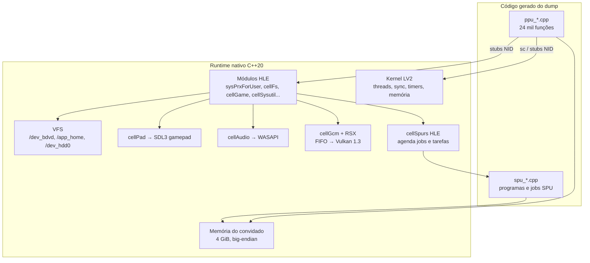

# Roteiro técnico do port nativo (Windows 10/11, x86-64)

Este documento junta tudo o que já foi levantado sobre o **Sly Cooper: Thieves in Time** (BCES01284) e define como chegar a um `.exe` nativo. A abordagem é **recompilação estática** do código do PS3 para C++20, com as bibliotecas do sistema reimplementadas em Win32 e Vulkan.

Dados de 2026-10-21. Os números vêm das ferramentas em `tools/`; a seção 1 diz qual gerou cada um.

---

## 1. Auditoria do que já existe

### 1.1 Disco

| Item | Conteúdo |
|---|---|
| `PS3_GAME/USRDIR/EBOOT.BIN` | SELF de 16,3 MB. Não há `.sprx` próprio no disco: todas as bibliotecas vêm do firmware |
| `PS3_GAME/USRDIR/Sly4.psarc` | 16,1 GB no disco, **79.027 arquivos, 19,9 GiB** descomprimidos (zlib, blocos de 64 KiB) |
| `PS3_GAME/USRDIR/Movies/` | 38 vídeos **Bink 1** (`BIKi`), 7,0 GB |
| `PS3_UPDATE/PS3UPDAT.PUP` | Atualização de firmware que veio no disco (256 MiB), referência para os módulos do sistema |

Conteúdo do `Sly4.psarc` (`tools/psarc_inventory.py`):

| Tipo | Arquivos | Tamanho | Formato | Estado |
|---|---|---|---|---|
| `.xvag` | 77.522 | 11,1 GiB | Áudio Sony: **MPEG (MP3)** em 99,8% dos arquivos, 48 kHz, em geral mono; 170 em **HEVAG** | Identificado, sem decodificador |
| `.san.cooked` / `.san` | 87 + 1 | 8,9 GiB | Fases em blocos Sanzaru (`FORM`): texturas, malhas, materiais, instâncias, esqueletos, Havok… | **Resolvido** para geometria, materiais, texturas, esqueletos e animação |
| `.ftd` | 333 | 242 MiB | Packfile Havok 2011.3 (cinemáticas in-game, IGC) | Lido pelo `havok.py`; ainda não exportado |
| `.tga` / `.bmp` | 64 | 84 MiB | Fontes e telas da interface | Formatos padrão |
| `.xmb` | 763 | 8 MiB | Scripts e configuração em XMLB | **Resolvido**; 85% dos nomes recuperados |
| `.str` | 19 | 9 MiB | Textos por idioma (`SSTRPS3`) | Não estudado |
| `.bfx_res` | 39 | 7,6 MiB | Grafo de navegação da IA (`NavGraph`) | Não estudado |
| `.sbnk` / `.bus` | 1 / 1 | 0,2 MiB | Banco e mixagem do **SCREAM** (motor de áudio da Sony) | Não estudado |
| `.mid` | 186 | — | Marcas de música interativa | Formato padrão |
| `.at9` | 6 | 0 | Arquivos vazios; ATRAC9 é o codec do Vita, provavelmente são sobras daquela versão | — |
| `Shaders.Zip` | 541 shaders | 0,7 MiB | Cg compilado para o RSX (326 VP, 215 FP) | Inventariado (`cgbin_info.py`) |

### 1.2 Subsistemas

**a) EBOOT.BIN → EBOOT.elf: concluído.**
- Descriptografado com `rpcs3.exe --decrypt` e gravado em `PS3_GAME/USRDIR/EBOOT.elf`.
- É um ELF PPC64 big-endian com ponteiros de 32 bits. O código fica em `0x10000–0xF05168` e os dados em `0xF10000+`.
- Descritor de entrada em `0xF3B2D8`; TOC (r2) = `0xF50800`, usado em 13.858 pontos.

**b) Extratores de assets.**

| Ferramenta | Faz | Estado |
|---|---|---|
| `psarc.py` | Lista e extrai o PSARC | Completo |
| `texr2dds.py` | TEXR/GTF → DDS | Completo: 49.981 texturas, todas DXT1/DXT5 |
| `xmlb2json.py` | XMLB → XML/JSON | Completo; 85% dos nomes de campo recuperados |
| `san2gltf.py` + `edge.py` + `havok.py` | Fases, malhas, EDGE com skinning e animações Havok → glTF | 87 fases; 1.730 personagens animados; 20.252 clipes |
| `cgbin_info.py` | Inventário dos shaders | Completo (parâmetros com nome, microcódigo bruto) |
| — | XVAG (áudio) | **Falta.** MP3 e HEVAG são formatos conhecidos |
| — | `.str`, `.bfx_res`, `.sbnk` | **Falta** |

**c) Binário PPU e chamadas ao sistema** (`eboot_scan.py`, Ghidra e `tools/ppc/opcode_stats.sh`).

| Medida | Valor |
|---|---|
| Funções (`.opd` + análise) | 24.172 |
| Instruções PPU | 2.795.351; 315 mnemônicos, dos quais **103 cobrem 99%** |
| Vetoriais (VMX/AltiVec) | 136.448 ocorrências, 70 tipos |
| Exclusivas do Cell | `lvlx` 4.380, `lvrx` 216, `stvlx` 241, `stvrx` 241 |
| Importações | 251 funções de 20 módulos, 241 com nome resolvido por NID |
| `sc` diretos | 376 pontos, 71 números de syscall distintos |
| Strings | 23.969 |
| Programas SPU | 10 ELFs embutidos, mais os jobs soltos no `.rodata` (por exemplo, o descompressor EDGE em `0xD5F4B0`) |
| Tratadores de bloco | 144 `Sly4_Chunk_*` nomeados no Ghidra (`registry:0x0055902c`) |

**Módulos importados, que vão precisar de implementação HLE:**

| Módulo | Funções | Papel no port |
|---|---|---|
| `cellSpurs` | 61 | Sistema de tarefas e jobs do SPU. Peça central |
| `sysPrxForUser` | 32 | lwmutex, threads, printf, memória: o "libc do kernel" |
| `cellGcmSys` | 29 | Interface com o RSX (gráficos) |
| `sys_fs` | 23 | Arquivos (`cellFs*`) |
| `cellSysutil` | 21 | Callbacks do sistema, diálogos, saves |
| `sys_net`, `cellNetCtl`, `cellHttp`, `cellSsl` | 28 | Rede: stub |
| `sceNp`, `sceNpTrophy`, `sceNpTus`, `sceNp2` | 28 | PSN e troféus: stub |
| `cellGame` | 7 | Caminhos do jogo e boot check |
| `cellAudio` | 7 | Saída de áudio (portas) |
| `sys_io` | 5 | Controle (`cellPad`) |
| `cellSysmodule` | 4 | Carregar módulos: no-op |
| `cellSync` | 3 | Primitivas PPU/SPU |
| `cellSysutilAvconfExt`, `cellRtc` | 3 | Vídeo e relógio |

**Syscalls LV2 chamadas diretamente,** agrupadas. Os números foram conferidos com a tabela do `lv2.cpp` do RPCS3:

| Grupo | Números |
|---|---|
| Processo | 14 (`sys_process_is_spu_lock_line_reservation_address`) |
| Threads PPU | 43–49 (yield, join, detach, prioridade, pilha) |
| Timers | 70–76 |
| Event flags | 82–87, 118 |
| Semáforos | 90–93 |
| Mutex e condição | 100–108 |
| RW lock | 120–127 |
| Filas e portas de evento | 128–138 |
| Tempo | 141 (`sys_timer_usleep`, 68 usos), 142, 144, 145, 147 |
| SPU | 156 e 260 (abrir imagem), 169 (inicializar), 181/182 (escrever/ler local store, 24 leituras), 190–192 (mailbox e eventos), 251/252 (eventos do grupo) |
| Memória e mmapper | 330, 331, 348, 351, 352 |
| TTY | 402, 403 |
| Arquivos | 801–804, 818 |
| Depuração | 988 (tratador de exceção do PPU; sem implementação no RPCS3) |
| Número não resolvido | 49 pontos (r11 vem de registrador) |

**Middleware embutido no EBOOT** (pelas strings). Ele é recompilado junto com o jogo, não reimplementado:
- **Havok 2011.3**: física (`hkp`), animação (`hka`) e comportamento (`hkb`);
- **Bink** (vídeo);
- **SCREAM**, o motor de áudio da Sony, com o plugin `scream_spu_plugin_pack_mp3` rodando no SPU e a `libMp3`;
- **EDGE**: geometria e zlib (`edgezlib_inflate_queue`);
- o motor da Sanzaru, chamado internamente de **"Ape"** (`ApeSpurs`, `ApeTFreeList`, `ApeSpurs_1SPU`).

Os códigos de licença do Havok citam `Sanzaru_SCEA_Sly4_PS-Vita`: o motor é o mesmo da versão Vita.

---

## 2. Estratégia

```
EBOOT.elf (do dump de cada um)
   │  recompilador PPU (ferramenta nossa)
   ▼
C++ gerado (24 mil funções) ──┐
SPU .elf/jobs → C++ gerado ───┼─► sly4.exe = código gerado + runtime nativo (C++20)
                              │        ├── memória do PS3 (4 GiB reservados)
                              │        ├── kernel LV2 + módulos HLE (Win32)
                              │        ├── RSX/GCM → Vulkan 1.3
                              │        └── áudio/controle/arquivos → SDL3 + Win32
Sly4.psarc + Movies (dump) ───┘  lidos em tempo de execução, sem conversão
```

Princípios:
1. **O código gerado nunca entra no repositório.** O build lê o `EBOOT.elf` de quem compila e gera o C++ localmente. O repositório distribui só o recompilador e o runtime. É o mesmo modelo dos ports por recompilação já existentes.
2. **Recompilar tudo o que é do jogo, reimplementar só o que é do sistema.** Havok, Bink, SCREAM, EDGE e o motor Ape são código do EBOOT ou dos SPUs e são recompilados. LV2, `cellGcm`, `cellFs`, `cellAudio`, `cellPad` e `cellSpurs` são do firmware e são reimplementados.
3. **O RPCS3 é o oráculo.** Toda dúvida de semântica (syscall, método do RSX, comportamento do SPURS) se resolve comparando com o que o RPCS3 faz. Ele também serve para comparar logs e quadros lado a lado.
4. **Os assets são lidos como estão.** O jogo lê o PSARC e os `.san` sozinho; as ferramentas Python servem para entender e validar, não para converter.

Referências de projeto: **XenonRecomp** (licença MIT), o recompilador PPC → C++ do Xbox 360 usado no *Unleashed Recompiled*. O Xenon também é PowerPC 64 com VMX e ponteiros de 32 bits, então o desenho dele serve quase direto. O RPCS3 (GPLv2) é referência de semântica; copiar código dele obrigaria o projeto a ser GPLv2, e essa decisão de licença precisa ser tomada antes.

---

## 3. Arquitetura do executável nativo



### 3.1 Memória e threads

**Espaço de endereços.**
- O PS3 usa ponteiros de 32 bits, então o runtime reserva **4 GiB contíguos** com `VirtualAlloc(MEM_RESERVE)`. Todo endereço do convidado vira `base + endereço`.
- As regiões são confirmadas (`MEM_COMMIT`) conforme o jogo as pede:
  - o ELF a partir de `0x10000`;
  - a memória de usuário (`sys_memory_allocate`, `sys_mmapper_*`);
  - as pilhas das threads;
  - a memória local do RSX (`0xC0000000`, 256 MiB) e a região de IO mapeada pelo `cellGcmMapMainMemory`.
- O resto fica reservado e sem acesso. Um *vectored exception handler* registra o endereço do convidado em qualquer acesso inválido, o que é o principal recurso de depuração.

**Big-endian.** Toda leitura e escrita do convidado passa por `load_be<T>` / `store_be<T>` (`_byteswap_*`, que vira `bswap`/`movbe`). Vetores de 128 bits invertem os 16 bytes com `pshufb`.

**PPU recompilado.**
- Cada função vira `void f_XXXXXXXX(PPUContext& c)`.
- O `PPUContext` guarda GPR[32] de 64 bits, FPR[32], VR[32] de 128 bits, CR, LR, CTR, XER, FPSCR e VSCR.
- Chamadas diretas (`bl`) viram chamadas C++.
- Chamadas indiretas (`bctrl`, 14.852 no jogo) passam por uma tabela endereço → função montada do `.opd` e das tabelas de salto. Um endereço desconhecido para com log.
- `sc` vai para o despachante de syscalls.
- Os stubs de importação (`.lib.stub`, `0xABFB10`) são trocados por chamadas às funções HLE, indexadas pelo NID.

**Semântica que precisa de cuidado.**

| Item | Tratamento |
|---|---|
| `lwarx`/`stwcx.`/`ldarx`/`stdcx.` | Reserva emulada com CAS atômico (`InterlockedCompareExchange`) |
| FPU | `fmadd` fundido (`std::fma`), arredondamento do FPSCR e conversões `fctiwz` |
| VMX | Modo não-Java (NJ): denormais zerados (FTZ/DAZ no MXCSR). `vrsqrtefp`/`vrefp` são estimativas, e a precisão precisa ser parecida para não mudar a física |
| Cell `lvlx`/`lvrx`/`stvlx`/`stvrx` | Cargas e gravações desalinhadas: `loadu` + máscara |
| Barreiras (`sync`, `lwsync`, `eieio`) | Fences do x86 só onde há memória compartilhada com SPU e RSX |

**Threads.**
- Cada `sys_ppu_thread_create` vira uma `std::thread` com `PPUContext` e pilha próprias.
- As primitivas do LV2 (lwmutex, mutex, cond, rwlock, semáforo, event flag, event queue/port) são implementadas no kernel HLE com `SRWLOCK`, `CONDITION_VARIABLE` e `WaitOnAddress`. A semântica de prioridade e de timeout precisa bater.

**SIMD.** VMX → SSE4.1 como base obrigatória, com caminhos AVX2 onde valer a pena. O SPU usa os mesmos 128 bits, então a camada de intrínsecos é compartilhada. A biblioteca SIMDe (MIT) cobre as instruções sem equivalente direto.

### 3.2 SPU e SPURS

**Recompilador SPU.** É o mesmo gerador com outro front-end:
- 128 registradores de 128 bits;
- local store de 256 KiB por SPU;
- `MFC` DMA (`get`/`put`/listas/atômicos `getllar`/`putllc`) vira `memcpy` e CAS na memória do convidado;
- canais (mailboxes, sinais, eventos) viram filas do runtime.

**Fontes de código SPU:**
- os 10 ELFs embutidos (`spu_extract.py`);
- os jobs soltos no `.rodata`, achados pelos descritores de job que o PPU monta;
- os plugins do SCREAM, carregados da memória.

**SPURS em HLE.** Não emulamos o kernel SPURS do firmware. Um *pool* de até 6 threads de host (os SPUs que o jogo pode usar) executa os *workloads*: *jobchains* para o EDGE e os jobs do motor, *tasksets* para SCREAM e Havok. São 61 funções importadas, e cada uma precisa ser mapeada para essa agenda.

**Atalho opcional.** Jobs conhecidos podem ser trocados por código nativo, identificados pelo hash do binário do job:
- `edgezlib` → zlib-ng;
- descompressão de índices EDGE → a rotina já entendida em `edge.py`.

O ganho é desempenho, e dá para validar comparando com a versão recompilada.

### 3.3 Renderização: `cellGcm`/RSX → Vulkan 1.3

O jogo escreve o *command buffer* do RSX (FIFO) na memória e avisa o `cellGcm`. O port precisa de três peças.

**1. `cellGcm` em HLE.** Ela cuida de:
- `cellGcmInit`, a memória local e o mapeamento de IO;
- `cellGcmSetFlipMode`, `cellGcmSetDisplayBuffer` e o flip;
- os *labels* e *reports* (sincronização PPU ↔ GPU);
- tiling e zcull, inicialmente só registrados.

**2. Consumidor do FIFO.** Uma thread lê os métodos NV40/NV47 (`NV4097_*`) e mantém um rastreador de estado:
- render targets, blending, profundidade, *stencil*, *viewport*;
- *vertex arrays* em big-endian, com formatos `s16n`, `half`, `CMP 11:11:10` e outros, já vistos no `san2gltf.py`;
- texturas em formatos GTF (DXT1/5, A8R8G8B8…), com *swizzle* e *tiling*.

Cada `DRAW_ARRAYS`/`DRAW_INDEX_ARRAY` vira um *draw* Vulkan.

**3. Tradutor de shaders.**
- O microcódigo de VP (`sce_vp_rsx`) e de FP (`sce_fp_rsx`) é traduzido para SPIR-V, gerando GLSL e compilando com o glslang.
- Os 541 programas do `Shaders.Zip` são traduzidos **em lote no build**; os que o jogo montar em tempo de execução usam um cache com hash.
- O RPCS3 tem a referência completa desses decodificadores.

**Por que Vulkan 1.3:**
- *dynamic rendering* e *extended dynamic state* aproximam o modelo de estado solto do RSX;
- SPIR-V é o alvo natural da tradução;
- é o mesmo backend do RPCS3, o que facilita comparar resultados;
- compila com MinGW sem o SDK do Windows.

O DirectX 12 pode virar um segundo backend depois.

O flip vira o *present* da *swapchain*. A janela, o *vsync* e o modo de tela cheia ficam com o SDL3.

### 3.4 Áudio e controle

**Áudio.** O jogo decodifica XVAG (MP3 e HEVAG) e mixa tudo **sozinho**, com SCREAM e `libMp3` no SPU, e entrega PCM às portas do `cellAudio`. O port só precisa implementar o `cellAudio`:
- portas com *ring buffer* de 2 ou 8 canais float a 48 kHz;
- um evento por bloco de 256 amostras;
- saída por WASAPI, via `SDL_AudioStream`.

Um decodificador XVAG próprio (minimp3 + HEVAG) vale como ferramenta de validação e como plano B, caso o SCREAM no SPU atrase.

**Controle.** O `cellPad` (`sys_io`) vira um *gamepad* do SDL3, que cobre XInput, DualShock 4/5 e DualShock 3. Botões analógicos e sensores seguem o formato `CellPadData`. Teclado e mouse ficam com um mapeamento configurável.

**Vídeo.** O Bink está no EBOOT e roda recompilado, sem trabalho extra. Se o caminho SPU do Bink atrasar, o plano B é substituir as chamadas do Bink por um decodificador nativo (o FFmpeg decodifica `BIKi`, licença LGPL).

### 3.5 Sistema de arquivos (VFS)

| Caminho do PS3 | No Windows |
|---|---|
| `/dev_bdvd/PS3_GAME/...` | Pasta do dump indicada pelo usuário (`--game C:\...\PS3_GAME`) |
| `/app_home/...` | Mesma pasta (`USRDIR`) |
| `/dev_hdd0/game/BCES01284/...`, saves e cache | `%LOCALAPPDATA%\sly4-port\hdd0\...` |
| `/dev_hdd1/` (cache temporário) | `%LOCALAPPDATA%\sly4-port\hdd1\` |

Detalhes:
- `cellFsOpen`/`Read`/`Lseek`/`Close`/`Stat`/`Opendir` (e os `sc` 801–818 diretos) usam um mapa de descritores sobre `CreateFileW`.
- Leituras assíncronas (`cellFsAio*`, se usadas) vão para um *pool* de I/O.
- O nome é tratado sem distinção de maiúsculas, como no disco do PS3.
- O `Sly4.psarc` de 16 GB é aberto uma vez e lido por `ReadFile` com *offset*; o jogo faz a própria descompressão.

### 3.6 Demais módulos

| Módulo | Tratamento |
|---|---|
| `cellGame` | Devolve os caminhos do VFS e o *boot check* "disco" |
| `cellSysutil` | Fila de callbacks (sair do jogo, menu XMB); `savedata` gravando em `hdd0`; diálogos viram log ou janela nativa |
| `cellSysmodule` | Load/unload sem efeito |
| NP, troféus, TUS, rede, HTTP e SSL | Stubs que respondem "offline / não conectado". Troféus podem virar um registro local depois |
| `cellRtc`, `sys_time` | Relógio do Windows; *timebase* de 79,8 MHz |
| `sys_tty_write` | Log do console |

---

## 4. Ambiente de build

O host continua só com Docker e Git.

| Peça | Escolha |
|---|---|
| Compilador | **MinGW-w64 GCC 14** (C++20, alvo `x86_64-w64-mingw32`, threads POSIX) em Docker, imagem `sly4-mingw:1`. Gera um `.exe` que roda direto no Windows. O llvm-mingw (clang) continua sendo opção se for preciso |
| Build | CMake + Ninja |
| Janela, áudio, controle | SDL3 (zlib) |
| Vulkan | Vulkan-Headers + volk (MIT); o *loader* vem do driver da GPU no Windows |
| Shaders | glslang + SPIRV-Tools (BSD/Apache), no build e em tempo de execução |
| SIMD | SIMDe (MIT) |
| Utilitários | fmt (MIT), xxHash (BSD), zlib-ng |
| Testes | Unitários das instruções (GoogleTest ou doctest) |

Estrutura proposta do repositório:

```
docs/                ROADMAP.md, notas por subsistema
tools/               ferramentas Python atuais (assets, análise)
recomp/              recompilador PPU e SPU: decodificador, análise, emissor C++
runtime/
  memory/            espaço do convidado, acesso big-endian
  cpu/               PPUContext, SPUContext, helpers VMX/SPU, despachante indireto
  kernel/            syscalls LV2, threads, sincronização, timers
  hle/               módulos: sysPrxForUser, cellFs, cellGcm, cellSpurs, cellAudio, cellPad...
  gpu/               FIFO RSX, estado, Vulkan, tradução de shaders
  vfs/
  loader/            ELF, .opd, .lib.stub, NIDs, TLS
app/                 main.cpp, configuração, janela
cmake/, docker/      toolchain llvm-mingw
generated/           (ignorado pelo git) C++ gerado do dump local
```

---

## 5. Fases do trabalho

As durações são estimativas para uma pessoa em dedicação parcial, com o Claude escrevendo a maior parte do código. Servem para ordenar, não como prazo. Cada fase termina num **critério de saída verificável**.

### Fase 0: fundação (1–2 semanas) — **concluída em 2026-10-21**
- Imagem Docker `sly4-mingw:1` (`docker/toolchain/Dockerfile`). Usa MinGW-w64 GCC 14 do Debian trixie em vez do llvm-mingw: são pacotes oficiais, com C++20 completo. Traz também CMake, Ninja, os headers do Vulkan e o SDL 3.2.0 estático.
- `docker/build.ps1` gera `build/mingw-release/sly4.exe`: um único arquivo de 4,9 MB, sem DLLs.
- `app/main.cpp` + `runtime/gpu/vulkan_context` abrem a janela com SDL3. A instância e o dispositivo são Vulkan 1.3, com *dynamic rendering* e *synchronization2*. A *swapchain* é recriada no redimensionamento, e um *clear* azul é apresentado a cada quadro. As funções do Vulkan são carregadas pelo SDL a partir do `vulkan-1.dll` do driver, sem precisar do Vulkan SDK.
- CI no GitHub Actions (`.github/workflows/build.yml`) com artefato `sly4-windows-x64`.
- **Saída verificada:** `sly4.exe --frames 300` sai com código 0 na RTX 5060 Ti: Vulkan 1.4.351, swapchain 1280×720 `B8G8R8A8_SRGB`, 145 fps com vsync (FIFO) e 7.500 fps em MAILBOX.

### Fase 1: memória e loader (1–2 semanas) — **concluída em 2026-10-21**
- `runtime/core/endian.h`: `load_be`/`store_be` para inteiros, `float` e `double` sem alinhamento.
- `runtime/memory/guest_memory`:
  - 4 GiB reservados; *commit* por página, com proteção `ReadOnly`/`ReadWrite`; `VirtualQuery` responde o que está confirmado;
  - acesso big-endian e `Vec128` com bytes invertidos;
  - `read_cstring` que para em memória não confirmada;
  - *handler* de exceção que traduz acessos inválidos para o endereço do PS3.
- `runtime/loader/elf_loader`:
  - valida ELF64 BE, `ET_EXEC` e `EM_PPC64`;
  - carrega os `PT_LOAD`, zera o `.bss` (2,9 MB) e deixa o código somente leitura no host;
  - lê o descritor de entrada (função `0x4FC7B4`, TOC `0xF50800`);
  - lê o TLS (`0xF55680`, 0x160 bytes), o `sys_process_param` (SDK 4.10, prioridade 1001, pilha de 64 KiB, malloc de 1 MiB) e o `sys_process_prx_param`;
  - lê as 20 entradas `sys_stub` da `.lib.stub`, com NIDs e *slots*. Os *slots* serão preenchidos pelo HLE na Fase 3.
- `runtime/loader/nid`: SHA-1 próprio e `nid_of(nome)`; nomes vindos de `tools/data/ps3_nid_candidates.txt`.
- `sly4.exe --game <PS3_GAME> [--no-window] [--dump-imports f.csv]`.
- `sly4_tests.exe`: 9 testes, entre eles vetores FIPS do SHA-1, NIDs conhecidos e o EBOOT real (via `SLY4_EBOOT`). Rodam também na CI, num runner Windows.
- **Saída verificada:** o EBOOT carrega em cerca de 25 ms, com 17,9 MiB confirmados. As 251 importações (20 módulos, 241 com nome) do `--dump-imports` são **idênticas, linha a linha e na mesma ordem**, às do `eboot_scan.py`.

### Fase 2: recompilador PPU (6–10 semanas) — **concluída** (2026-10-21)

Andamento em [RECOMP.md](RECOMP.md):
- **2a, decodificador (concluída):** nas 2,8 milhões de instruções, o texto é idêntico ao do binutils em tudo o que ele decodifica (0 divergências).
- **2b, análise de fluxo (concluída):** 23.913 funções e 251 stubs, 301 mil blocos, as 178 tabelas de salto resolvidas e 0 instruções inválidas alcançadas. Nenhuma palavra que o binutils rejeita foi classificada como código.
- **2c, interpretador de referência (concluída):** inteiros, FPU (FPSCR completo) e VMX (modo NJ). Validado contra execução PowerPC real no QEMU: 195 instruções, 195 mil casos, 0 divergências. As diferenças explicadas (desvios do QEMU, comportamento indefinido, estimativas) são contadas e documentadas.
- **2d, gerador de C++ (concluída):** a semântica virou uma função `inline` por instrução, compartilhada entre o interpretador e o código gerado. Blocos viram rótulos, desvios viram `goto`, `bl` vira chamada direta, tabelas de salto viram `switch`, e o despacho indireto usa uma tabela de funções com o interpretador de reserva.
- **2e, EBOOT inteiro (concluída):** 24.164 funções e 2,77 milhões de instruções em 98 arquivos que compilam em 6,7 min sem avisos. No diferencial contra o interpretador, 98.332 casos foram comparados e todos deram iguais.

Plano original da fase, para referência:

- **Decodificador próprio** (as tabelas do binutils servem de referência): 315 mnemônicos, cerca de 200 operações-base.
- **Análise:** limites de função (`functions.csv` e Ghidra), tabelas de salto e dados no meio do código. Há 10.044 palavras no `.text` que o objdump não decodifica (`.long`), e cada uma precisa ser classificada como tabela ou dado.
- **Emissor C++,** operação a operação, por prioridade:
  - inteiros e desvios (os 103 mais comuns cobrem 99%);
  - FPU;
  - VMX (70 tipos);
  - Cell `lvlx`/`lvrx`;
  - reservas atômicas.
- **Código gerado** em arquivos de cerca de 500 funções, para compilar em paralelo, e despachante indireto.
- **Teste diferencial:** um interpretador PPC mínimo, escrito junto, executa cada instrução com entradas aleatórias, e o resultado é comparado com o código emitido.
- **Saída:** os 2,8 milhões de instruções geram C++ que compila sem erro, e o diferencial passa para todas as operações usadas.

### Fase 3: kernel e HLE básico, "o jogo boota" (4–6 semanas) — **concluída** (2026-10-21)

Andamento em [KERNEL.md](KERNEL.md):
- **3a, partida do processo (concluída):** o EBOOT recompilado roda a partir do ponto de entrada real. As 251 importações estão ligadas a funções nativas, as 71 syscalls têm nome e cada chamada nova é registrada. O jogo inicializa memória, SPURS e `cellGame`, escreve no TTY e para esperando a primeira thread que ainda não existe.
- **3b, threads, sincronização e memória (concluída):** threads PPU em threads do Windows, os objetos de sincronização do LV2 (lwmutex, mutex, cond, rwlock, semáforo, event flag, filas e portas de evento, timers) e o `sys_mmapper`. O jogo cria 5 threads, sobe o FIOS (o sistema de arquivos da Sony) e faz as primeiras chamadas de arquivo.
- **3c, arquivos e módulos de sistema (concluída):** VFS, `cellFs` e `sc` 801–818, `cellGame` lendo o `PARAM.SFO`, `cellSysutil`, `cellSysmodule`, `cellRtc` e rede desconectada. O jogo abre o `Sly4.psarc`, lê o índice e monta o cache em `/dev_hdd1`. Depois para esperando a primeira descompressão, que o FIOS entrega a uma tarefa SPU do SPURS.
- **3d, até o `cellGcmInit` (concluída):** um SPURS mínimo (event flags e LFQueue) e a tarefa SPU de descompressão (EDGE zlib) trocada por código nativo, com um decodificador DEFLATE próprio. O jogo descomprime o psarc, termina o FIOS e chega ao `cellGcmInit`. No caminho apareceu e foi corrigido um sinal "roubado" no `signal_all` das condições. Comparado ao RPCS3 (com o firmware do disco), o TTY sai idêntico linha a linha até o `cellGcmInit`, assim como a sequência de arquivos e os endereços de memória.

Plano da fase:
- Syscalls: threads, sincronização, timers, memória, TTY e arquivos.
- `sysPrxForUser`, `cellFs` sobre o VFS, `cellGame`, `cellSysutil` mínimo, `cellSysmodule`, `cellRtc`, e stubs de NP e rede.
- Tudo o que não existe ainda registra a chamada e devolve `CELL_OK`, para mapear o que o jogo precisa.
- **Saída:** o jogo roda o `main`, cria as threads, abre o `Sly4.psarc`, lê arquivos (com log comparável ao do RPCS3) e chega ao `cellGcmInit`.

### Fase 4: SPU e SPURS (6–10 semanas)
- Recompilador SPU (mesmo emissor, ISA SPU) e `SPUContext` com local store, MFC e canais.
- `cellSpurs` em HLE: *workloads*, *jobchains*, *tasksets* e eventos.
- Catálogo de quem usa o quê: EDGE (geometria e zlib), Havok, SCREAM e mp3, Bink.
- **Saída:** os jobs `edgezlib` descomprimem o conteúdo de uma fase com resultado idêntico ao do `psarc.py`/`san2gltf.py`, e as threads de áudio e física rodam sem travar.

### Fase 5: RSX → Vulkan (8–14 semanas)
- `cellGcm` em HLE e consumidor do FIFO com rastreador de estado.
- *Vertex fetch*, texturas e *render targets*.
- Tradutor VP/FP → SPIR-V, validado primeiro nos 541 shaders do `Shaders.Zip`.
- Flip para a *swapchain*.
- Comparação quadro a quadro com o RPCS3, usando capturas do mesmo ponto.
- **Saída:** a splash da Sanzaru e o menu principal aparecem corretos.

### Fase 6: áudio, controle e vídeo (3–5 semanas)
- `cellAudio` → WASAPI; `cellPad` → SDL3; Bink rodando (recompilado ou, no plano B, FFmpeg).
- **Saída:** menu com música, navegação pelo controle e a abertura em vídeo.

### Fase 7: POC, primeira fase jogável (4–8 semanas)
- Novo jogo → Prólogo em Paris: carregamento da fase, física Havok e IA (`NavGraph`).
- Correção de bugs pela comparação de logs e quadros com o RPCS3.
- **Saída:** a primeira fase carrega, renderiza e o Sly anda e pula com o controle.

### Fase 8: do POC ao jogo completo (contínuo)
- Todas as fases e minijogos, saves, desempenho (60 FPS estáveis, threads), resolução e *widescreen* acima de 720p.
- Empacotamento: um instalador que recebe o dump do usuário, gera o código e compila.
- Opcional: backend DirectX 12, troféus locais e *mods* (o formato dos assets já é conhecido).

**Trabalho paralelo de ferramentas** (Python, a qualquer momento):
- decodificador XVAG → WAV, como plano B de áudio e para validação;
- `.str` (textos), `.bfx_res` (navegação), `.sbnk` (SCREAM);
- exportação das cinemáticas `.ftd`;
- catálogo de funções do EBOOT por subsistema: Ape, Havok, EDGE, SCREAM, Bink e bibliotecas da Sony.

---

## 6. Primeira ação: `runtime/memory/guest_memory.h` (+ `.cpp`)

É a base de tudo: o loader, o código recompilado (PPU e SPU) e todos os módulos HLE leem e escrevem a memória do convidado por ela. Esboço da interface; `Protection` e `Vec128` serão definidos junto:

```cpp
// runtime/memory/guest_memory.h
namespace sly4 {

using GuestAddr = uint32_t;            // ponteiros do PS3 são de 32 bits

class GuestMemory {
public:
    bool reserve();                    // VirtualAlloc(MEM_RESERVE) de 4 GiB
    bool commit(GuestAddr a, uint32_t size, Protection p);
    void decommit(GuestAddr a, uint32_t size);

    uint8_t* host(GuestAddr a) const { return base_ + a; }

    template <class T> T    read(GuestAddr a) const;   // big-endian → host
    template <class T> void write(GuestAddr a, T v);   // host → big-endian
    Vec128 read128(GuestAddr a) const;                 // 16 bytes invertidos (pshufb)
    void   write128(GuestAddr a, Vec128 v);

    std::optional<GuestAddr> guest_of(const void* p) const;  // para o handler de exceção
private:
    uint8_t* base_ = nullptr;
};

}  // namespace sly4
```

Ordem dos primeiros arquivos:
1. `runtime/memory/guest_memory.{h,cpp}`, com testes de endianness e de *commit*/proteção;
2. `runtime/loader/elf_loader.{h,cpp}`: carrega o `EBOOT.elf` e valida entrada, TOC e importações (critério da Fase 1);
3. `app/main.cpp` + `docker/` + `CMakeLists.txt`: o primeiro `sly4.exe`, que carrega o EBOOT e abre a janela da Fase 0.

---

## 7. Riscos e como reduzi-los

| Risco | Mitigação |
|---|---|
| Semântica sutil de VMX/FPU muda física e animação | Teste diferencial por instrução; FTZ/DAZ; estimativas com a mesma precisão do Cell |
| Desvios indiretos sem destino conhecido | Tabela do `.opd` + análise de tabelas de salto; fallback que registra o endereço e para |
| SPURS é complexo e pouco documentado | Usar o RPCS3 como oráculo; começar pelos *workloads* que o jogo usa de fato |
| RSX: muitos métodos e formatos | Implementar por demanda, guiado pelo log de métodos desconhecidos; comparar quadros com o RPCS3 |
| Corridas entre PPU, SPU e RSX | *Labels* e *reports* com atomics e *fences* corretos; modo de depuração serializado |
| Tamanho do C++ gerado (cerca de 2,8 milhões de instruções) | Dividir em centenas de arquivos, build paralelo, cache de compilação, `-O1` nas partes frias |
| Jurídico | Repositório privado; código e assets gerados só a partir do dump de cada um; nada da Sony versionado |

**Alternativa a considerar mais tarde:** a versão PS Vita usa o mesmo motor (vide os códigos do Havok) num único binário ARMv7, sem SPU e sem RSX. Recompilar ARM → x86 elimina a Fase 4 e simplifica a Fase 5 (GXM em vez de RSX), mas exige um dump da versão Vita e tem conteúdo de menor resolução.
